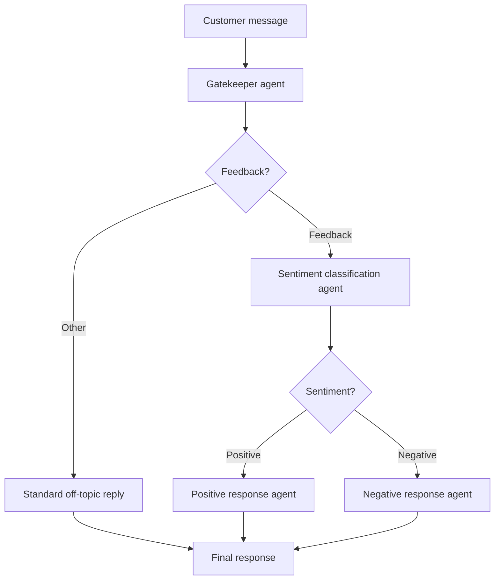

# Multi-Agent Customer Feedback Lab

A browser-based teaching application demonstrating **LLM-powered task specialization, guardrails, and conditional routing with LangGraph**. Built with Python, Streamlit, and Groq-hosted `openai/gpt-oss-20b`, it first checks that a message really is customer feedback, then classifies it and generates a response using the appropriate specialist agent. Messages that are not customer feedback (general questions, homework, chit-chat, prompt-injection attempts) receive a fixed, polite standard reply.

**Live application:** https://multi-agent-classroom.streamlit.app/

## What the application does

1. A user enters a message in the Streamlit interface.
2. The **gatekeeper agent** decides whether the message is customer feedback (`Feedback`) or something else (`Other`).
3. If it is `Other`, the workflow returns a **standard off-topic reply** written in the code. No further model calls are made.
4. If it is `Feedback`, the **sentiment agent** classifies it as `Positive` or `Negative` (choosing the dominant sentiment if mixed).
5. LangGraph selects one of two branches:
   - **Positive response agent:** thanks the customer in a concise, professional manner.
   - **Negative response agent:** acknowledges the problem, apologizes, and invites follow-up without promising unauthorized compensation.
   Both response agents are also told to ignore any unrelated question hidden inside the feedback.
6. The interface displays the gatekeeper decision, the sentiment, the generated response, and the workflow state.



A feedback message makes **three LLM requests** (gatekeeper, sentiment, response). An off-topic message makes **one** (gatekeeper only). All specialist functions share the same hosted model; they differ in their instructions and responsibilities. This is a **graph-orchestrated, multi-agent teaching example**, not an autonomous system with independent models or external tools.

## Technology

- **Python 3.11** — application language
- **Streamlit** — interactive web interface
- **LangGraph** — workflow state, nodes, and conditional edges
- **Groq Python SDK** — hosted model inference
- **`openai/gpt-oss-20b`** — default open-weight model served through Groq (not the OpenAI API)

The Groq service requires an API key. Free-tier usage is subject to model availability and account-specific rate limits; free hosting and free API quotas are not unlimited.

## Project structure

```text
multi-agent-classroom/
├── app.py             # Streamlit user interface
├── agents.py          # Groq calls, label checking, and four specialist agents
├── workflow.py        # LangGraph state, nodes, and routing
├── test_workflow.py   # Offline tests with a fake LLM (no API key needed)
├── requirements.txt   # Python dependencies
├── README.md          # Documentation
└── .gitignore         # Files excluded from Git
```

## Run locally

1. Install Python 3.11 and clone the repository.
2. Create a virtual environment (recommended), activate it, and install dependencies:

   ```bash
   python -m pip install -r requirements.txt
   ```

3. Run the offline tests (no key needed):

   ```bash
   python test_workflow.py
   ```

4. Set the environment variable `GROQ_API_KEY` to your key. Optionally set `GROQ_MODEL=openai/gpt-oss-20b`.
5. Start the application:

   ```bash
   streamlit run app.py
   ```

6. Open the local URL shown in the terminal.

The app reads the API key from environment variables or Streamlit secrets. Never commit keys to GitHub or paste them into public logs.

## Deploy to Streamlit Community Cloud

1. Push the project files to a GitHub repository with `app.py` at its root.
2. Open https://share.streamlit.io/ and create an application from the repository, using branch `main` and main file path `app.py`.
3. Select **Python 3.11** in advanced settings.
4. In **Secrets**, enter the following TOML, replacing the placeholder with your own key:

   ```toml
   GROQ_API_KEY = "your_groq_api_key_here"
   GROQ_MODEL = "openai/gpt-oss-20b"
   ```

5. Deploy and test feedback and off-topic examples. Streamlit installs packages from `requirements.txt`.

Create and manage your Groq API key at https://console.groq.com/keys. Consult https://console.groq.com/docs/rate-limits for published limits and your account dashboard for applicable quotas.

## Try it

| Message | Expected path |
|---|---|
| I love your service! The staff were helpful. | Feedback → Positive response agent |
| I hate your services. The delivery was late. | Feedback → Negative response agent |
| What is the capital of France? | Other → standard off-topic reply |
| Write me a poem about the sea. | Other → standard off-topic reply |
| The delivery was late. Also, what is 2 + 2? | Feedback → Negative response agent, which declines the maths question |

Exact response wording can vary between model calls; the off-topic reply is always identical because it is written in the code.

## Code walkthrough

### `agents.py`

- `OFF_TOPIC_REPLY` is the fixed standard reply for messages that are not customer feedback.
- `ask_llm(system_prompt, message, max_tokens=400)` sends a system instruction and the message to the Groq chat-completions API. It reads the model name at call time, requests low reasoning effort, and checks for an empty visible response.
- `pick_label(answer, labels)` normalizes minor formatting differences and accepts only an allowed label, otherwise raising an error.
- `gatekeeper_agent(message)` returns `Feedback` or `Other`.
- `sentiment_agent(feedback)` returns `Positive` or `Negative`.
- `positive_agent(feedback)` and `negative_agent(feedback)` generate the replies; `STAY_ON_TOPIC` tells both to ignore unrelated requests.

### `workflow.py`

- `FeedbackState` defines `feedback`, `scope`, `sentiment`, and `response` fields.
- `check_scope` runs the gatekeeper; `route_scope` sends the run to `classify` or `off_topic`.
- `reply_off_topic` writes the standard reply without calling the model.
- `classify` and `route_sentiment` choose the positive or negative node.
- `run_workflow(feedback)` invokes the compiled graph and returns its final state.

### `app.py`

The Streamlit interface accepts input, runs the graph, handles errors, shows the gatekeeper and sentiment decisions, and displays the resulting state for inspection.

## Classroom exercises

1. Identify the graph's nodes, state variables, start/end points, and both conditional edges.
2. Test positive, negative, mixed, and off-topic messages. Find a message the gatekeeper gets wrong.
3. Add a **Neutral** classification, a neutral-response agent, and a third conditional route.
4. Merge the gatekeeper and sentiment agent into one call with three labels. Compare cost and accuracy.
5. Test malformed or adversarial messages and discuss output validation and prompt-injection defenses.
6. Measure request latency and estimate the number of API calls needed for a class demonstration.

## Operational considerations

- **Rate limits:** Each feedback run usually makes three Groq API requests; an off-topic run makes one. Multiple simultaneous students can reach free-tier limits quickly.
- **Model output:** LLM responses are not guaranteed to follow instructions perfectly. Both classifiers validate labels and report unexpected outputs instead of silently routing them. The gatekeeper can still make mistakes; it reduces off-topic answers but does not guarantee zero.
- **Reasoning tokens:** The classifiers allocate enough completion tokens for the selected reasoning model; an empty visible response is treated as an error.
- **Security:** Messages are sent to Groq for processing. Avoid entering confidential customer information or real personal data in this classroom demonstration.
- **Reliability:** Internet access, Groq service availability, and Streamlit hosting are required. Test the deployment before teaching.
- **Scope:** This is an educational prototype, not a production customer-service system. Human review and business authorization are required for consequential customer actions.

## License

No repository-wide license is specified here. Add a `LICENSE` file if you want to grant others explicit permission to reuse or redistribute the project.
